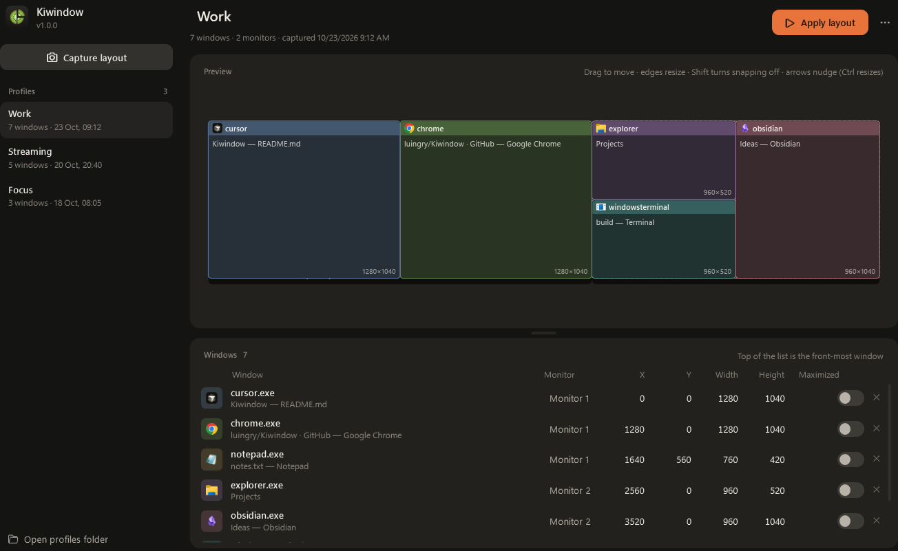

<p align="center">
  
</p>

<h1 align="center">Kiwindow</h1>

<p align="center">
  <strong>Your window layouts, back in place with one click.</strong><br />
  Save where every window sits across your monitors. Kiwindow reopens what's closed and puts everything back.
</p>

<p align="center">
  <a href="https://github.com/luingry/Kiwindow/releases/latest"></a>
  
  
  
  
</p>

<p align="center">
  <a href="https://github.com/luingry/Kiwindow/releases/latest"><b>⬇ Download for Windows</b></a>
  &nbsp;·&nbsp;
  <a href="#how-it-works">How it works</a>
  &nbsp;·&nbsp;
  <a href="#swisstechknife-module">SwissTechKnife module</a>
  &nbsp;·&nbsp;
  <a href="#for-developers">For developers</a>
</p>

<p align="center">
  
</p>

## Why

You spend minutes every morning dragging the same windows to the same places: the editor on the left, the browser on the right, chat on the second monitor, that one folder in the corner. Then a driver update, a dock unplug or a restart scrambles it all again.

Kiwindow remembers it for you. Arrange things once, capture the layout, and bring it back whenever you want.

- **One click.** Apply a profile and every window jumps to its place, at its size, in the right stacking order.
- **Reopens what's closed.** Apps, the files they had open and Explorer folders are launched again and placed as soon as they appear.
- **Many monitors, many setups.** Keep a profile for work, one for streaming, one for focus. Maximized windows land on the right monitor.
- **Edit without fiddling.** Fix a layout on a map of your monitors: drag to move, pull an edge to resize, snap to screen edges and other windows.
- **Fast and local.** Windows that are already open move in parallel, a frozen app never holds the others back, and nothing leaves your PC.

## Getting started

1. Download `Kiwindow-<version>-setup.exe` from the [latest release](https://github.com/luingry/Kiwindow/releases/latest) and run it. No administrator rights needed.
2. Arrange your windows the way you like them.
3. Open Kiwindow and click **Capture layout**. Give the profile a name (click the title to rename it).
4. Later, pick the profile and click **Apply layout**, or hover it in the list and press ▶.

## How it works

| You want to… | Do this |
|---|---|
| Save the current layout | **Capture layout** |
| Put everything back | **Apply layout** (unsaved edits are applied too) |
| Move or resize a window in the profile | Drag it on the map; drag an edge to resize. Hold **Shift** to turn snapping off. Arrow keys nudge, **Ctrl + arrows** resize |
| Type exact positions | Edit X, Y, width and height in the window list |
| Change which window is on top | Right-click a window: **Bring to front**, **Move up**, **Send to back**… The top of the list is the front-most window |
| Copy where a window is right now | Right-click it: **Use the open window's current position** |
| Refresh a whole profile | **⋯ → Replace with the windows open now**, review, then **Save** |
| Apply a profile from a shortcut or a hotkey tool | **⋯ → Copy shortcut command**, paste it into a Windows shortcut |

Changes are saved with **Save** (or **Ctrl + S**); **Discard** goes back to the saved version.

### Command line

```text
Kiwindow.exe --apply "Work"      apply a profile without opening the window (no name = most recent)
Kiwindow.exe --capture "Work"    capture the current layout as a new profile
```

## SwissTechKnife module

Kiwindow is also a module of [SwissTechKnife](https://github.com/luingry/SwissTechKnife), the app that brings small Windows tools together. Open SwissTechKnife → **Modules** → **Kiwindow** → **Install**. You get the same screen inside SwissTechKnife, plus **Capture layout** and **Apply "…"** for your recent profiles in its notification-area menu.

The standalone app and the module share the same profiles, so you can use either one, or both.

## Where your data lives

Profiles are plain JSON files in `%LOCALAPPDATA%\Kiwindow\profiles` (**Open profiles folder** at the bottom left). Uninstalling keeps them. The last apply is described in `%LOCALAPPDATA%\Kiwindow\last-apply.log`, handy if a window does not land where you expected.

## Good to know

- Store apps (UWP) that were closed cannot be reopened; if they are open, they are placed normally.
- Apps that open everything in one window with tabs (some browsers, editors and the Windows 11 Explorer) may open a file or folder as a new tab in a window that is already open. Kiwindow tells you when that happens.
- Kiwindow cannot move windows of apps running as administrator unless it runs as administrator too (a Windows rule).

## Requirements

Windows 10 or 11. .NET Framework 4.8 is already part of Windows.

## For developers

```powershell
powershell -File scripts/build.ps1              # build + tests + SwissTechKnife module package
powershell -File scripts/build.ps1 -Installer   # + installer (Inno Setup 6)
powershell -File scripts/render-brand.ps1       # after editing the logo
```

- [Architecture, releases and conventions](docs/DEVELOPMENT.md)
- Known problems and their fixes: [ERRORS.md](ERRORS.md)

## License

[MIT](LICENSE) © luingry
